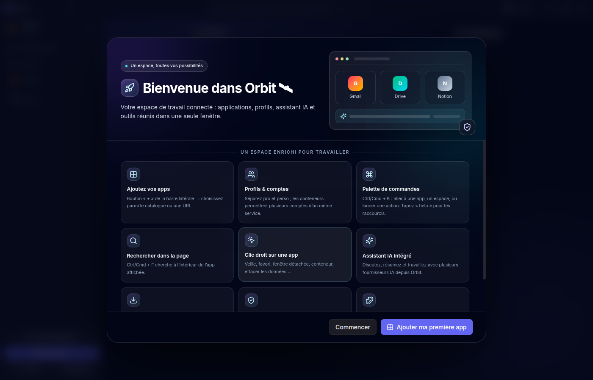
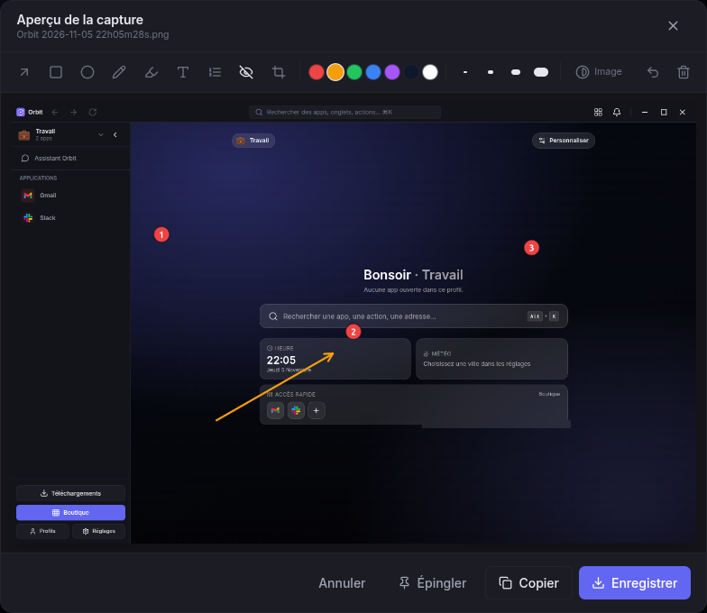
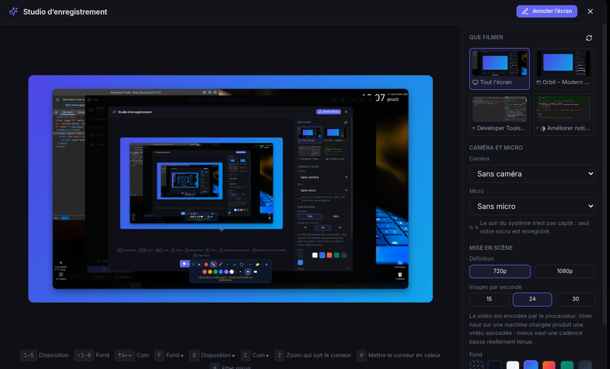
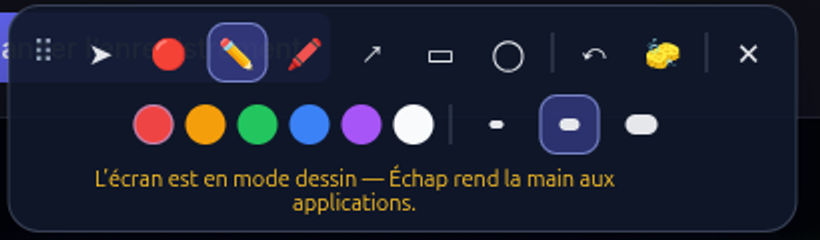
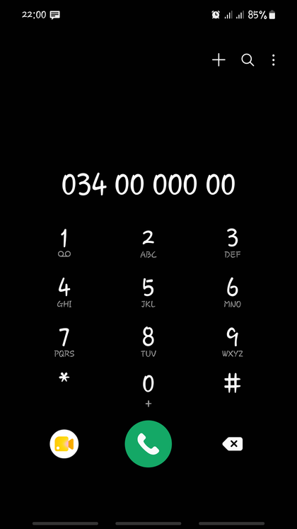

# Orbit — guide utilisateur

## Présentation

**Orbit rassemble vos applications web dans une seule fenêtre.** Au lieu de
vingt onglets et trois navigateurs ouverts, un espace unique où chaque service
a sa place, sa session et ses réglages — et autour, les outils qui manquent
toujours : capture et annotation, enregistrement d'écran, coffre-fort,
assistant, et jusqu'à votre téléphone Android.

Ce guide est écrit pour être lu dans l'ordre la première fois, puis consulté par
section. Chaque fonctionnalité y est décrite de la même façon : **à quoi elle
sert**, **comment y accéder** (bouton *et* raccourci clavier), et **ce qu'elle
donne**.

| | |
| --- | --- |
| **Application** | Orbit — Windows, macOS, Linux |
| **Auteur** | Clarco RAHERINANDRASANA |
| **Ce document** | Guide utilisateur complet, en français |
| **Mise à jour** | Généré à partir du dépôt à chaque version |

> **Conventions.** Les touches sont écrites `Alt+K`. Sur macOS, le modificateur
> **Alt** devient généralement **⌘**. Les libellés, extensions et raccourcis
> peuvent évoluer : ceux affichés dans **Réglages → Raccourcis** font foi pour
> votre installation.

## 1. Découvrir Orbit

Orbit est une application de bureau pour Windows, macOS et Linux. Elle ouvre vos
services web dans des vues intégrées et les organise dans une barre latérale.
Chaque profil peut regrouper ses propres applications, connexions, apparence et
espace de travail.

### Ce qu’Orbit rassemble

- Applications web et liens personnels dans un espace configurable.
- Profils et sessions isolées, avec partage de connexion facultatif au sein d’un
  profil (SSO).
- Conteneurs pour utiliser plusieurs comptes d’un même service.
- Écran partagé, espaces de travail, fenêtres détachées et dossiers d’apps.
- Recherche, assistant IA, correcteur, coffre-fort et gestionnaire de
  téléchargements.
- Extensions optionnelles, dont Text Snippets, Fake Data Filler et Web Clipper.
- Orbit Phone en extension optionnelle pour piloter un appareil Android
  compatible.

Orbit ne remplace pas les services web que vous ajoutez : leur disponibilité, les
connexions et leurs règles de confidentialité restent celles de leurs éditeurs.

## 2. Installer et lancer Orbit

Téléchargez la version publiée depuis la
[page des releases GitHub](https://github.com/Clarco-Mada-digital/orbit/releases/latest).
Choisissez le format correspondant au système :

| Système | Formats publiés |
|---|---|
| Windows | Installateur `.exe` ou version portable `.exe` |
| Linux | `.AppImage` ou paquet Debian `.deb` |
| macOS | Image disque `.dmg` ou archive `.zip` |

L’application n’est pas signée pour toutes les plateformes. Windows
SmartScreen ou macOS Gatekeeper peuvent afficher un avertissement d’éditeur non
identifié. Vérifiez que le téléchargement vient bien de la release du dépôt
officiel avant de décider de poursuivre.

Au premier démarrage, l’écran de bienvenue permet d’ajouter une première app ou
de commencer avec un espace vide. Installez vos applications via la boutique
intégrée ou ajoutez une URL web.

## 3. Organiser son espace

### Applications

- Utilisez **+** ou la boutique pour ajouter une app.
- Ajoutez une URL personnelle si le service n’est pas dans le catalogue.
- Réorganisez la liste par glisser-déposer ; créez des dossiers pour regrouper
  les apps.
- Le clic droit sur une app donne accès aux actions telles que favori, veille,
  fenêtre détachée, déplacement de profil ou gestion de session.
- La **fenêtre détachée** garde les gestes d’un navigateur : `Ctrl + molette`
  pour le zoom (aussi `Ctrl +`, `Ctrl -` et `Ctrl 0`), `Ctrl + R` ou `F5` pour
  recharger, `Alt + ←/→` pour l’historique. Le clic droit y propose copier,
  coller, précédent, suivant, recharger et le zoom.
- Le zoom y reste appliqué pendant toute la durée de la fenêtre (il survit aux
  changements de page) et un badge affiche brièvement le pourcentage atteint.

### Profils et sessions

Créez des profils séparés, par exemple Travail et Personnel. Par défaut, les
sessions sont cloisonnées pour réduire les mélanges de comptes. L’option de
partage de connexion d’un profil rapproche le comportement d’un navigateur :
les apps du profil peuvent partager la session d’un même service. Les conteneurs
servent à garder plusieurs comptes séparés lorsque c’est nécessaire.

Avant de changer le mode de partage, lisez l’avertissement affiché dans Orbit :
les apps peuvent être rechargées et certaines sessions nécessiter une nouvelle
connexion.

### Espaces, fenêtres et apparence

- Placez plusieurs apps côte à côte dans l’écran partagé et enregistrez une
  disposition dans un espace de travail.
- Détachez une app dans une fenêtre séparée lorsque vous souhaitez la déplacer
  sur un autre écran.
- Personnalisez le thème, la couleur d’accent, les polices et les modules
  affichés dans les barres.
- Chaque profil peut avoir ses réglages d’accueil et de fond distincts.

### Espaces de travail

Un espace de travail mémorise **le profil, l’application affichée et l’écran
partagé** du moment. Le bouton **Espaces de travail** de la barre du haut
(icône en damier) les liste ; ils apparaissent aussi dans la palette `Alt+K`.

| Action | Où |
| --- | --- |
| Enregistrer la disposition actuelle | Bouton **Enregistrer la disposition actuelle**, puis un nom |
| Rouvrir un espace | Clic sur son nom (barre du haut ou `Alt+K`) |
| Réenregistrer un espace sur la disposition actuelle | Icône disquette, au survol de la ligne |
| Supprimer | Icône corbeille, au survol de la ligne |

Réenregistrer évite de supprimer puis recréer un espace quand on veut
simplement l’ajuster — il garde son nom et sa place dans la liste.

## 4. Recherche et raccourcis utiles

Sur Windows et Linux, les raccourcis Orbit utilisent généralement **Alt**. Sur
macOS, le modificateur équivalent est généralement **⌘**. Les apps web conservent
leurs raccourcis propres.

| Raccourci | Action |
|---|---|
| `Alt/⌘ + K` | Recherche et palette de commandes |
| `Alt/⌘ + ,` | Réglages |
| `Alt/⌘ + Maj + O` | Boutique d’applications |
| `Alt/⌘ + Maj + P` | Gestion des profils |
| `Alt/⌘ + L` | Modifier l’URL de la page active |
| `Alt/⌘ + Page ↓ / Page ↑` | App suivante / précédente |
| `Alt/⌘ + Maj + Page ↓ / Page ↑` | Profil suivant / précédent |
| `Ctrl + F` ou `⌘ + F` | Rechercher dans la page |
| `Ctrl + R` ou `⌘ + R` | Recharger l’app active |
| `Alt/⌘ + Maj + E` | Relire le champ actif hors ligne |
| `Alt/⌘ + Maj + I` | Ouvrir la relecture IA du texte actif |
| `Alt/⌘ + Maj + A` | Ouvrir la discussion IA |

Les raccourcis IA peuvent être configurés. La liste à jour et les réglages
personnalisés se trouvent dans Orbit.

### Ce que la palette sait faire

`Alt/⌘ + K` ne cherche pas que des apps. Elle calcule (`4*4`, `20% de 150`),
convertit (`10 km en mi`, `255 in hex`), ouvre une adresse, retrouve une page
**déjà visitée** et, si un trousseau est déverrouillé, **copie un mot de passe**
ou un code à usage unique sans passer par les réglages. Le mot de passe ne
transite pas par l’interface : Orbit l’écrit lui-même dans le presse-papiers et
le vide après 30 secondes. Les identifiants n’apparaissent qu’à partir de deux
caractères saisis — jamais à l’ouverture de la palette.

### Historique de navigation

Les pages visitées alimentent cette recherche. Pour l’effacer :

- dans la palette, le bouton 🗑 d’une page (ou `Maj + Suppr`) l’oublie seule ;
- les commandes **« oublier la dernière heure »** et **« vider tout
  l’historique »** s’y trouvent aussi, avec une confirmation ;
- **Réglages → Confidentialité → Historique de navigation** indique ce qui est
  mémorisé, permet d’arrêter l’enregistrement et de vider par période.

Les pages de connexion et les adresses porteuses de jetons ne sont jamais
enregistrées, et l’historique ne quitte pas la machine : il n’entre pas dans la
synchronisation.

### Choisir ce que la palette cherche

**Réglages → Général → Recherche (Alt+K)** active ou coupe séparément chaque
source : pages déjà visitées, pages ouvertes en ce moment, identifiants des
trousseaux déverrouillés et code à usage unique. Les apps, profils, actions,
calculs et conversions restent toujours disponibles.

## 5. Assistant IA et relecture

Orbit propose un assistant de discussion, des outils de résumé et de rédaction,
ainsi qu’une relecture. Le mode local facultatif télécharge un modèle sur
l’appareil ; il peut demander de l’espace disque, de la mémoire et un matériel
compatible.

Des fournisseurs distants peuvent aussi être configurés. La connexion à ces
services et le traitement des textes dépendent du fournisseur. Lisez la
confirmation présentée par Orbit avant d’envoyer du contenu. Les clés API
configurées sont protégées par le stockage sécurisé du système lorsqu’il est
disponible.

Le correcteur rapide fonctionne localement. Un moteur grammatical LanguageTool
local peut être installé en option ; il nécessite Java 17 ou plus récent et un
téléchargement initial conséquent. Les règles rapides restent disponibles si le
moteur complet n’est pas installé.

## 6. Coffre-fort de mots de passe

Le coffre-fort intégré stocke les identifiants dans des trousseaux protégés par
un mot de passe maître. Déverrouillez uniquement lorsque vous souhaitez
consulter ou utiliser les entrées. Les fonctions de santé du coffre peuvent
signaler les mots de passe faibles ou réutilisés et, si vous l’activez, vérifier
les mots de passe compromis à travers un service externe.

Lors de cette vérification facultative, Orbit calcule localement une empreinte
SHA-1 et n’envoie que les cinq premiers caractères au service Have I Been
Pwned ; le service voit néanmoins l’adresse IP et l’heure de la requête.
Consultez les explications affichées dans les réglages de santé avant de
l’activer.

### Rapatrier une base KeePassXC

Si vous utilisez KeePassXC, le bouton **🗄 Rapatrier la base KeePassXC** de la
barre d’outils du trousseau recopie ses identifiants dans le trousseau Orbit
ouvert. KeePassXC doit tourner, sa base être déverrouillée, Orbit être associé
(Réglages → KeePassXC) et l’option **« Allow limited access to all entries in
connected databases »** être cochée dans KeePassXC → Paramètres → Intégration
navigateur → Avancé.

Les entrées déjà présentes ne sont pas dupliquées : Orbit les reconnaît par
domaine et nom d’utilisateur, puis vous demande s’il faut les fusionner
(compléter les champs vides) ou les écraser. Les entrées KeePassXC **sans URL**
ne peuvent pas être récupérées — le protocole ne rend les mots de passe que site
par site ; Orbit en donne la liste à la fin pour que vous les repreniez à la
main.

### Déverrouillage et code 2FA

Au déverrouillage, une case permet de **mémoriser le mot de passe maître sur
cet appareil**. Il est alors gardé par le trousseau du système, jamais en clair
sur le disque — mais quiconque ouvre une session sous votre compte pourra
ouvrir ce trousseau sans le connaître. C’est à vous de juger ; l’option est
désactivée par défaut, par trousseau, et s’oublie d’elle-même si vous changez
le mot de passe maître.

Pour les comptes à double facteur, un bouton **⏱ Code 2FA** apparaît dans la
page après un remplissage : il remplit le champ de code, ou le copie si le
champ n’existe pas encore. Il se coupe dans **Réglages → Mots de passe**, avec
le choix des sources d’identifiants.

### Sauvegarde automatique

**Réglages → Mots de passe → Sauvegarde automatique chiffrée** écrit à
intervalle régulier une archive `.orbitvault` dans le dossier de votre choix,
en ne conservant que les N dernières. Deux points à connaître :

- la **phrase de passe** des archives est gardée par le trousseau du système.
  Notez-la ailleurs : sans elle, les archives sont illisibles, y compris pour
  vous ;
- seuls les **trousseaux déverrouillés** peuvent être archivés — Orbit n’a pas
  la clé des autres. L’écran indique lesquels ont été laissés de côté.

Préférez un support différent de celui d’Orbit : une sauvegarde sur le même
disque ne protège pas d’une panne de ce disque.

### Sauvegarder et exporter à la main

Le bouton **Exporter** propose deux choses différentes :

- **Sauvegarde chiffrée** (recommandé) : un fichier `.orbitvault` chiffré en
  AES-256-GCM, dont la clé est dérivée par scrypt de la phrase de passe que vous
  choisissez (à défaut, le mot de passe maître). C’est le format à poser sur une
  clé USB ou un cloud : il conserve tout le trousseau (catégories, URLs
  secondaires, favoris, historique des mots de passe) et se restaure dans Orbit
  avec le bouton **🗃 Restaurer une archive chiffrée**.
- **Export en clair CSV / JSON** : réservé à une migration vers un autre
  gestionnaire. Ces fichiers contiennent tous vos mots de passe lisibles ;
  supprimez-les dès la migration terminée.

Dans les deux cas, l’export exige de resaisir le mot de passe maître — un écran
laissé sans surveillance ne doit pas pouvoir sortir les secrets d’un clic.

## 7. Captures d’écran, annotation et enregistrement

### Prendre une capture

`Alt+Maj+S` ouvre le menu de capture. Quatre voies, parce que la question posée
est la même — « je veux montrer ce que j’ai à l’écran » — et qu’on ne sait pas
toujours d’avance si une image suffira :

| Touche | Voie |
| --- | --- |
| `1` | Zone visible de la page |
| `2` | Page entière, défilement compris |
| `3` | Choisir une zone à la souris |
| `4` | Enregistrer une vidéo (studio) |

Un **délai** réglable (0 à 10 s) laisse le temps de préparer l’écran ; `Échap`
annule le compte à rebours.

### Annoter la capture avant de l’enregistrer

L’aperçu qui suit la capture n’est pas qu’un aperçu : c’est un éditeur. Tout est
dessiné **dans l’image**, donc « Enregistrer » et « Copier » rendent exactement
ce qui est affiché. Une capture à laquelle on n’a pas touché part telle quelle,
sans ré-encodage.

| Outil | À quoi il sert |
| --- | --- |
| **Flèche** | Désigner un élément précis |
| **Rectangle**, **Ellipse** | Entourer une zone |
| **Dessin libre** (stylo) | Tracer à main levée |
| **Surligneur** | Attirer l’œil sans masquer ce qui est dessous |
| **Texte** | Écrire sur l’image (`Entrée` valide, `Maj+Entrée` passe à la ligne) |
| **Étape numérotée** | Poser des pastilles **1**, **2**, **3**… |
| **Masquer (pixelliser)** | Rendre une zone illisible |
| **Recadrer** | Ne garder qu’une partie de la capture |

Quelques précisions utiles :

- **Les étapes numérotées** servent à documenter un parcours : chaque clic pose
  la pastille suivante, et la numérotation se fait toute seule. Si vous annulez
  la pastille 3, le clic suivant redonne un 3 — pas un 4. L’épaisseur choisie
  dans la barre d’outils commande la taille de la pastille, comme elle commande
  la taille du texte.
- **Le masquage est une pixellisation en blocs**, pas un flou : sur du texte, un
  flou se devine encore, des blocs non.
- **Le recadrage ne déplace pas les annotations.** Il change la zone regardée ;
  le bouton **Tout l’écran** revient à la capture entière sans rien perdre.
- Les curseurs **Luminosité**, **Contraste** et **Saturation** (bouton
  **Image**) s’appliquent à l’enregistrement comme à l’aperçu.
- **Annuler** retire la dernière annotation, **Tout effacer** remet la capture
  dans son état d’origine, réglages compris.

### Masquer les données sensibles en un clic

Partager une capture, c’est parfois partager ce qu’on n’avait pas vu. Orbit
repère **dans la page**, avant la capture, les adresses **e-mail**, les
**IBAN**, les numéros de **carte** bancaire et de **téléphone** — c’est le seul
moment où le texte est encore du texte, avec ses coordonnées.

Si quelque chose est trouvé, un bouton ambré **« Masquer N donnée(s)
sensible(s) »** apparaît dans la barre d’outils. Orbit propose, vous décidez :
chaque zone devient un masque ordinaire, que vous pouvez annuler un par un.

Les numéros de carte sont vérifiés par la clé de Luhn et les IBAN par le
modulo 97, pour ne pas masquer une référence de commande qui leur ressemble. Le
repérage concerne les captures « zone visible » et « page entière ».

### Épingler une capture

Le bouton **Épingler** place la capture — annotée ou non — dans une petite
fenêtre flottante **toujours visible**, pour la garder sous les yeux pendant
qu’on travaille. Elle se déplace en la saisissant n’importe où, se
redimensionne en conservant ses proportions, et plusieurs épinglages se décalent
en cascade.

Au survol, une barre apparaît : **opacité** (quatre niveaux, pour lire à
travers), **copier**, **enregistrer**, **fermer**. Au clavier : `Ctrl+C`,
`Ctrl+S`, `O` pour l’opacité, `Échap` pour fermer.

### Enregistrer une vidéo (studio)

Le studio filme un écran ou une fenêtre, avec ou sans caméra, et le met en
scène : fond uni ou dégradé, marge, coins arrondis, ombre portée. Tout est
composé sur un canvas, et c’est ce canvas qui est enregistré — **l’aperçu est
la vidéo**.

**Cinq dispositions** : *écran seul*, *écran + pastille*, *caméra seule*,
*côte à côte*, et **présentation**. Cette dernière donne la priorité à ce qui
porte l’information : la capture garde toute la hauteur et presque toute la
largeur, la caméra devient une vignette posée à mi-hauteur sur le côté choisi.
Son **cadrage** se règle d’une touche (`O`) :

- **chevauché** — la vignette mord sur la capture, comme une incrustation de
  plateau ;
- **espacé** — même vignette, mais un écart la sépare de la capture.

Changer de disposition, de cadrage ou de fond ne coupe pas l’image : la
composition **glisse** vers sa nouvelle place en une fraction de seconde, et le
fond passe en fondu. Un réglage qu’on fait glisser (taille de la pastille,
marge) reste lui immédiat.

Pendant la prise, ces touches évitent de rouvrir le panneau et de sortir du
cadre :

| Touche | Effet |
| --- | --- |
| `1`–`5` | Aller directement à une **disposition** |
| `Maj`+`1`–`8` | Aller directement à un **fond** |
| `↑` `↓` `←` `→` | Placer la caméra, un axe à la fois |
| `F` | Faire défiler les **fonds** |
| `D` | Faire défiler les **dispositions** |
| `C` | Changer le **coin** de la caméra |
| `Z` | **Zoom** qui suit le pointeur |
| `H` | **Halo** du curseur |
| `M` | Effet **miroir** de la caméra |
| `V` | **Anneau de voix** autour de la caméra |
| `X` | **Coup de zoom** sur le curseur, qui revient tout seul |
| `O` | **Cadrage** de la présentation : chevauché ou espacé |
| `C` | En présentation : **hauteur de pose** de la vignette |
| `Alt`+`1`–`5` | Rappeler un **cadrage mémorisé** |
| `A` | **Annoter l’écran** (voir ci-dessous) |
| `P` | **Pause** / reprise |
| `S` | **Arrêt** |
| `R` | **Réduire** le studio en une barre |

Chaque touche **annonce ce qu’elle vient de changer** sous l’aperçu, et dit
quand le réglage ne se voit pas encore (le cadrage sans caméra, par exemple) :
un raccourci sans effet visible est sinon indiscernable d’un raccourci cassé.

**Depuis l’application que vous filmez.** Les touches ci-dessus ne répondent
que si Orbit a le focus — or pendant une prise, vous êtes ailleurs. Le temps
de l’enregistrement, Orbit pose donc les mêmes actions en raccourcis système :
`Alt+Maj+D` (disposition), `Alt+Maj+F` (fond), `Alt+Maj+C` (place de la
caméra), `Alt+Maj+Z` (zoom suivi), `Alt+Maj+X` (coup de zoom), `Alt+Maj+O`
(cadrage), `Alt+Maj+P` (pause) et `Alt+Maj+K` (arrêt). Ils sont libérés à la
fin de la prise. La liste affichée sous l’aperçu ne montre que ceux qui ont
réellement pu être enregistrés : votre gestionnaire de fenêtres s’en réserve
parfois un.

« Réduire » est ce qui permet de filmer Orbit lui-même : il ne reste qu’un
chronomètre, la pause, l’arrêt et l’annotation. La cadence **réellement tenue**
est affichée pendant l’enregistrement — une vidéo saccadée se découvrirait
sinon à la relecture.

**Mettre en valeur et rythmer la prise.** Le **coup de zoom** (`X`) rapproche
l’image de votre curseur pendant trois secondes puis revient tout seul : c’est
le geste qu’on fait au moment de montrer quelque chose, là où un zoom permanent
finit par donner le mal de mer. L’**anneau de voix** (`V`) fait respirer un
liseré autour de la caméra au rythme de ce que capte le micro : on voit qui
parle. Un **carton de titre** peut ouvrir la vidéo : saisissez-le avant la
prise, il s’affiche quelques secondes puis s’efface pendant que la composition
se découvre dessous. Enfin, la **pause** fige l’image avec un bandeau qui reste
une fraction de seconde dans la vidéo : à la relecture, la coupure se lit comme
voulue.

**Cadrages mémorisés.** Une démonstration client et un tutoriel ne se filment
pas pareil. Le panneau **Cadrages mémorisés** enregistre la mise en scène du
moment sous un nom (jusqu’à cinq) et la rappelle d’un clic ou d’un `Alt`+chiffre.
La définition et la cadence n’en font pas partie : ce sont des réglages propres
à la machine, et les imposer donnerait une vidéo saccadée sans qu’on comprenne
pourquoi.

### Annoter l’écran pendant une démonstration

La touche `A` (ou le bouton **Annoter l’écran**) ouvre une couche de dessin
**par-dessus tout l’écran**, pas seulement par-dessus Orbit. C’est une vraie
fenêtre : un enregistrement ou une capture la reprennent telle quelle.

Dans sa palette : **pointeur laser** (avec traîne), **stylo**, **surligneur**,
**flèche**, **rectangle**, **ellipse**, six couleurs, trois épaisseurs,
**annuler** (`Ctrl+Z`) et **tout effacer**. La palette se déplace par sa poignée
`⠿`.

Le **mode pointeur** (➤) est la clé : la couche devient traversante, vos clics
vont aux applications qui sont dessous et les tracés restent affichés par-dessus.
`Échap` revient au pointeur, un second `Échap` ferme la couche.

## 8. Téléchargements et extensions

### Gestionnaire de téléchargements

La page **Téléchargements** rassemble les fichiers, l’historique, les
téléchargements de médias pris en charge et les réglages de destination. Vous
pouvez choisir un dossier permanent ou demander un emplacement à chaque
téléchargement. Les liens magnet sont transmis au client torrent associé par le
système ; Orbit n’est pas lui-même un client torrent.

La disponibilité du téléchargement de vidéos/audio dépend des outils et des
conditions du site source. Respectez les droits d’auteur, les conditions
d’utilisation et les lois applicables.

### Installer une extension Orbit

Ouvrez **Réglages → Extensions**. Les extensions distribuées séparément peuvent
être installées depuis leur archive ZIP. Une extension n’est activée qu’après
installation et activation. Les extensions du Chrome Web Store ne sont pas
toutes compatibles avec Electron.

Les extensions livrées avec Orbit sont **inertes tant qu’elles ne sont pas
installées** : ni leur code ni leurs fonctionnalités ne sont chargés. Quand une
version plus récente est livrée avec une mise à jour d’Orbit, le bouton
**Mettre à jour** apparaît en face de l’extension, avec la version installée.

- **Text Snippets** : remplace les abréviations configurées (par défaut, par
  exemple `;email`) par leur texte complet dans les champs compatibles. La
  conversion se produit au fil de la saisie.
- **Fake Data Filler (Orbit)** : 🎲 ou `Alt+F` remplit le champ focalisé ;
  `Alt+Maj+F` remplit les champs visibles du formulaire actif. Les champs de
  connexion sont ignorés. Les valeurs sont générées localement ; les champs
  personnalisés se règlent dans Extensions. Un champ qui attend une image
  (avatar, couverture, photo de produit) reçoit un fichier PNG dessiné sur
  l’appareil, sans aucun envoi réseau. Les champs d’adresse de photo
  reçoivent un portrait ou une photo aléatoire, ce qui peut être coupé par
  « Photos et images de test » dans les réglages de l’extension.
  Les types reconnus couvrent aussi le sexe, la date de naissance, l’âge,
  l’IBAN (clé valide) et les cartes de test (numéro valide au sens de Luhn,
  expiration et cryptogramme).
- **Web Clipper** : conserve localement une sélection ou le contenu principal
  d’une page, puis permet de rechercher et d’exporter les captures en Markdown.
- **Souris & Défilement** : défilement **lissé** et réglable (souplesse, pixels
  par cran, vitesse, sens inversé, `Maj`+molette pour l’axe horizontal,
  défilement rapide avec `Alt`), **défilement automatique** au clic du milieu
  maintenu, et une **palette de présentation** (`Alt+Maj+D`) : pointeur laser,
  stylo, surligneur, flèche, rectangle, ellipse, couleurs, épaisseurs, spot
  lumineux, halo de clic, curseur mis en évidence. Le pavé tactile est laissé
  tranquille (il défile déjà en continu) et les applications qui pilotent la
  molette elles-mêmes — cartes, Figma, éditeurs de code — ne sont jamais
  touchées. Une règle par site permet de couper le lissage là où il gêne.
- **Color Picker** : pipette de couleur intégrée, bouton flottant 🎨 ou `Alt+C`.
- **QR Code Generator** : QR code de la page ou d’un texte, `Alt+Q`. Entièrement
  local, aucune requête réseau.
- **Sticky Notes** : un bloc-notes attaché au domaine courant (`Alt+N`), qui se
  rouvre à chaque visite du site.
- **Page to Markdown** : convertit la page en Markdown et la télécharge
  (`Alt+M`, ou le menu contextuel).
- **Téléphone Orbit** : extension optionnelle pour piloter un Android
  compatible. Voir la section suivante.

### Téléphone Orbit

Une fois l’extension **Téléphone Orbit** installée, un bouton **Téléphone**
apparaît dans la barre du haut, avec le nombre de notifications du mobile.
Branchez l’appareil en USB avec le **débogage USB** activé (ou en sans-fil,
Android 11+), puis installez le moteur scrcpy embarqué depuis le panneau :
Orbit le télécharge dans ses propres données, sans toucher au système.

L’accueil du Téléphone se compose de **widgets** que l’on ajoute ou retire
(bouton **Ajouter un widget**) :

| Widget | Ce qu’il montre |
| --- | --- |
| **Horloge** | Heure et date de l’appareil |
| **Appareil et batterie** | Modèle, charge, état de la connexion |
| **Applications favorites** | Les apps épinglées en tête |
| **Applications récentes** | Les dernières ouvertes depuis Orbit |
| **Notifications** | Les alertes du mobile, avec « Tout effacer » |
| **Contrôles rapides** | Volume, Wi-Fi, Bluetooth, réglages Android, envoi de fichier |
| **Appels récents** | Le journal d’appels, avec rappel en un clic |

Ce sont des widgets **Orbit** : les widgets Android publiés par des
applications ne sont pas hébergés ici, cela demanderait un hôte de widgets natif
sur Android.

#### Appels

- **Appel entrant** : un bandeau s’affiche au-dessus d’Orbit avec **Décrocher**
  et **Refuser**. Il dit **qui** appelle — beaucoup de téléphones titrent
  seulement « Appel entrant » et laissent l’identité ailleurs, alors Orbit lit
  les autres champs de la notification, interroge la radio au besoin, puis
  cherche le nom dans **vos contacts**. Si rien n’est transmis (numéro masqué,
  appel d’une application qui ne dit rien), il l’annonce franchement au lieu
  d’afficher un libellé qui ne nomme personne. Le bandeau indique aussi depuis
  combien de temps ça sonne.
- **Appels récents** : le journal du mobile, appels manqués en évidence, avec la
  durée et l’horodatage. **Rappeler** lance l’appel depuis le téléphone ;
  **Préparer** ouvre son clavier avec le numéro prêt, à confirmer sur
  l’appareil — un appel ne part jamais par surprise. Un numéro masqué est
  signalé comme tel.

#### Applications et fichiers

- Chaque application s’ouvre dans **sa propre fenêtre de bureau** (scrcpy 3.0+,
  Android 11+). Le bouton **Miroir** reste une session séparée qui affiche
  l’écran physique.
- Jusqu’à **huit applications épinglées** dans une pastille flottante toujours
  accessible dans Orbit. Poussée contre le bord gauche ou droit, elle **se
  replie en languette** et ne laisse qu’un onglet discret : un clic la rouvre,
  un glissement la ramène où vous voulez. Un point rouge sur la languette
  signale les notifications en attente.
- **Envoyer un fichier** (contrôles rapides) dépose un ou plusieurs fichiers
  dans les **téléchargements** du téléphone.

> **Répondre à un SMS depuis Orbit n’est pas possible**, et ce n’est pas un
> oubli : l’action « Répondre » d’une notification Android est réservée à
> l’application qui l’a posée, et ADB ne peut pas la déclencher. De même, le
> presse-papiers partagé n’a pas d’équivalent ADB sur Android récent — dans une
> fenêtre miroir, scrcpy le synchronise déjà dans les deux sens.

### Visionneuse de documents

Un fichier `.md`, `.txt`, `.json`, `.csv` ou un fichier de code ouvert dans
Orbit s’affiche dans une visionneuse plutôt que d’être téléchargé. Pour le
Markdown, le rendu couvre les titres (dièses ou soulignés), les listes et cases
à cocher, les tableaux, le code, les citations et les **alertes GitHub**
(`> [!NOTE]`, `> [!WARNING]`…), les **formules mathématiques** TeX (`$x^2$`,
`$$…$$`, `\(…\)`, `\[…\]`), les **notes de bas de page** numérotées — cliquez le
renvoi pour y aller, la flèche ↩ pour revenir — et les **lecteurs audio et
vidéo**.

Pour protéger votre lecture, ni les images ni les médias d’un document distant
ne sont chargés d’office : un média s’ouvre au clic, une image reste une
pastille qui mène au navigateur. Le bouton **Source** affiche le fichier brut.

## 9. Confidentialité et sécurité

- Les profils et applications utilisent des sessions web isolées selon la
  configuration ; le SSO est facultatif.
- Le stockage des cookies dans les versions empaquetées utilise le mécanisme de
  chiffrement d’Electron et le trousseau du système lorsqu’il est disponible.
- Les données de l’assistant local et de la relecture rapide restent sur
  l’appareil. Les fonctions connectées envoient les données nécessaires au
  fournisseur choisi.
- Fake Data et Text Snippets n’ont pas besoin de services externes pour
  fonctionner. Seule exception, facultative et désactivable : les adresses de
  photo de test (portraits de stock et photos aléatoires), qui ne sont que des
  liens insérés dans le champ — aucune donnée de la page n’est envoyée.
- Les services web intégrés continuent de recevoir les données que vous saisissez
  directement sur leurs pages.

Protégez votre compte système, votre mot de passe maître et vos fichiers de
sauvegarde. Le chiffrement local ne remplace pas une sauvegarde sécurisée.

## 10. Dépannage

**Une app reste blanche ou ne se connecte pas**

Vérifiez votre connexion, rechargez la page, puis vérifiez que le service n’est
pas en panne. Si une app a perdu sa session, reconnectez-vous. En dernier
recours, utilisez les commandes de gestion de données de cette app en sachant
qu’une suppression de cookies vous déconnectera.

**Une extension ne réagit pas**

Vérifiez qu’elle est installée et activée dans **Réglages → Extensions**. Après
une modification d’extension, rechargez l’app web. Pour Text Snippets, vérifiez
le déclencheur et l’abréviation dans ses options. Certaines pages, champs
protégés et contenus fournis par des extensions tierces peuvent limiter
l’injection.

**L’assistant local ne démarre pas**

Vérifiez le modèle installé, la mémoire disponible et la compatibilité GPU
indiquée dans les réglages. Le fournisseur en ligne reste une option séparée.

**LanguageTool ne démarre pas**

Vérifiez que Java 17 ou plus récent est installé. Orbit indique la commande
adaptée aux distributions prises en charge ; les règles rapides restent
utilisables sans Java.

**Où trouver les diagnostics et l’aide ?**

Consultez **Réglages → Diagnostic** puis ouvrez une
[discussion GitHub](https://github.com/Clarco-Mada-digital/orbit/issues) en
fournissant le système, la version d’Orbit et les étapes reproductibles. Ne
joignez pas de mots de passe, cookies ou données privées.

## 11. Liens utiles

- [Télécharger Orbit](https://github.com/Clarco-Mada-digital/orbit/releases/latest)
- [Code source](https://github.com/Clarco-Mada-digital/orbit)
- [Guide PDF](./guide-utilisateur.pdf)
- [Guide développeur](./guide-developpeur.md)
- [Page de présentation](./index.html)

---

**Orbit** · Développé par **Clarco RAHERINANDRASANA** · Licence MIT.
